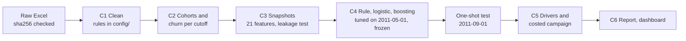

<!-- Generated by `python -m churn.run_c6` from docs/templates/README.md. Do not edit by hand. -->
# Customer churn and retention analytics

Which customers of a UK online retailer will stop buying in the next 90 days? Why? And would a
retention offer pay for itself? This project uses two years of real transactions to answer all
three. Every model is judged on a later month it never saw, and every £ figure is labelled as an
estimate under stated assumptions.

**Read the findings:** [docs/REPORT.md](docs/REPORT.md) · **Explore:** `streamlit run app/streamlit_app.py`

## Results (out of time: frozen models scored once on 2011-09-01)

4,323 active customers, 2,181 of them churned (50.5% base rate).
95% bootstrap intervals in brackets.

| Model | PR-AUC (95% CI) | ROC-AUC (95% CI) | Precision, top 10% | Precision, top 20% |
|---|---|---|---|---|
| Recency rule | 0.679 (0.657 to 0.701) | 0.708 (0.692 to 0.723) | 73.7% (319.1 of 433) | 71.7% (619.8 of 865) |
| Logistic regression | 0.730 (0.709 to 0.753) | 0.769 (0.755 to 0.783) | 79.2% (343 of 433) | 76.2% (659 of 865) |
| Gradient boosting | 0.746 (0.726 to 0.767) | 0.772 (0.758 to 0.786) | 83.1% (360 of 433) | 78.3% (677 of 865) |

- Gradient boosting beats the recency rule: the 95% intervals of PR-AUC, precision in the top 10%, precision in the top 20% do not overlap.
- Gradient boosting vs logistic regression is not settled: their 95% intervals overlap on PR-AUC, precision in the top 10%, precision in the top 20%.

## Key findings

1. Churn was 61.3% to 67.0% at the training cutoffs and 50.5% on the test
   month. Most new customers do not come back in any given month.
2. Gradient boosting ranks churners well: 83.1% (360 of 433) of its top 10% churned, against
   73.7% (319.1 of 433) for a "days since last purchase" rule. Its probabilities run too high,
   though (64.1% predicted vs 50.5% seen).
3. The strongest signals are orders and revenue in the past year, time as a customer and days
   since the last purchase (`orders_365d`, `net_revenue_365d`, `tenure_days`, `recency_days`).
4. Central-case plan (estimate: margin 30%, save rate 10%, offer £15): contact
   1,567 customers for an expected net benefit of £22,621. The optimum is flat
   (any size from 812 to 2,453 gets within 90%), and the best size depends far more on the
   assumptions (21 to 4,212 customers across 27 scenarios).
5. After the fact, 35.9% of the chosen customers churned against 51.9% predicted, and
   the plan recomputed with what actually happened gives £7,473. Measure the save rate with a
   controlled campaign before trusting the £ figures.

## How it works



| Step | Code | Write-up |
|---|---|---|
| C1 Load and clean | `src/churn/run_c1.py` | [docs/C1_data_and_cleaning.md](docs/C1_data_and_cleaning.md) |
| C2 Cohorts and churn | `src/churn/run_c2.py` | [docs/C2_cohorts_and_churn.md](docs/C2_cohorts_and_churn.md) |
| C3 Snapshots and features | `src/churn/run_c3.py` | [docs/C3_snapshots_and_features.md](docs/C3_snapshots_and_features.md) |
| C4 Models, validation, one-shot test | `src/churn/run_c4.py`, `run_c4_test.py`, `render_c4_test.py` | [docs/C4_models.md](docs/C4_models.md) |
| C5 Drivers and business layer | `src/churn/run_c5.py` | [docs/C5_drivers_and_business.md](docs/C5_drivers_and_business.md) |
| C6 Report, dashboard, README | `src/churn/run_c6.py`, `app/streamlit_app.py` | [docs/REPORT.md](docs/REPORT.md) |

## Reproduce

Python 3.13 (pinned with 3.13.5). The full run was checked on an 8 GB laptop.

1. Get the data: download https://archive.ics.uci.edu/static/public/502/online+retail+ii.zip, unzip
   it, and put `online_retail_II.xlsx` in `data/raw/`. The loader refuses any file whose sha256 is not
   `bcbe73b35f5b7babf197fb0cb983a11f5d9ff929078d4aa53d171b1f2df2e980`.
2. Install and run:

```bash
python3 -m venv .venv
.venv/bin/pip install -r requirements.txt && .venv/bin/pip install -e .
.venv/bin/python -m churn.run_c1
.venv/bin/python -m churn.run_c2
.venv/bin/python -m churn.run_c3
.venv/bin/python -m churn.run_c4
.venv/bin/python -m churn.render_c4_test
.venv/bin/python -m churn.run_c5
.venv/bin/python -m churn.run_c6
.venv/bin/python -m pytest && .venv/bin/python -m pytest -m realdata
```

`run_c4` refits the models, and `run_c5` refuses to run unless their sha256 matches the frozen
record (`results/c4_final_models.json`), so a rerun has to reproduce the exact same models.
**Do not run `churn.run_c4_test`.** It scored the test month once, and it refuses to run again
because `results/c4_test_metrics.json` exists. The clean-clone check is in
[docs/C6_reproducibility.md](docs/C6_reproducibility.md).

The dashboard needs only the committed files in `results/` and `config/`:

```bash
.venv/bin/streamlit run app/streamlit_app.py
```

## Data and licence

Data: Chen, D. (2012). *Online Retail II* [Dataset]. UCI Machine Learning Repository.
https://doi.org/10.24432/C5CG6D. Licensed under
[CC BY 4.0](https://creativecommons.org/licenses/by/4.0/). The raw file is not in this repository
(see Reproduce). Files in `results/` are derived from it.

Code: MIT licence ([LICENSE](LICENSE)).

## Assumptions

All in `config/`, each with a written rationale. The business ones:

| Assumption | Central | Scenarios | Source |
|---|---|---|---|
| Gross margin | 30% | 20%, 30%, 40% | Not in the data (plan default) |
| Save rate (share of contacted would-be churners kept) | 10% | 5%, 10%, 20% | Not observable here (plan default) |
| Offer cost per contacted customer | £15 | £5, £15, £40 | Author's judgement, adopted 2026-10-14; not checked with a retailer |
| Customer value | 12-month net revenue, floored at £0 |  | `net_revenue_365d` |

## Limitations

- The £ figures rest on assumed margin, save rate and offer cost. Nothing here shows that an offer
  causes anyone to stay.
- A kept customer is valued at 12 months of revenue, while "churned" means only 90 days without a
  purchase, so the benefits are likely overstated.
- The probabilities ran high on the test month. The lower test churn may be seasonal
  (pre-Christmas buying) or a trend: TO VERIFY, and one autumn of data cannot tell them apart.
- Many customers are wholesale buyers of very different sizes. The top 1% hold 29.0% of
  12-month revenue.
- The data are from 2009-2011 and come from one retailer.

## Author

Aradhya Chandra. Built with Claude Code as a coding assistant. The definitions, review decisions
and business assumptions are mine. Decisions and open questions are logged in `NOTES.md`, and
progress milestone by milestone in `PROGRESS.md`.
