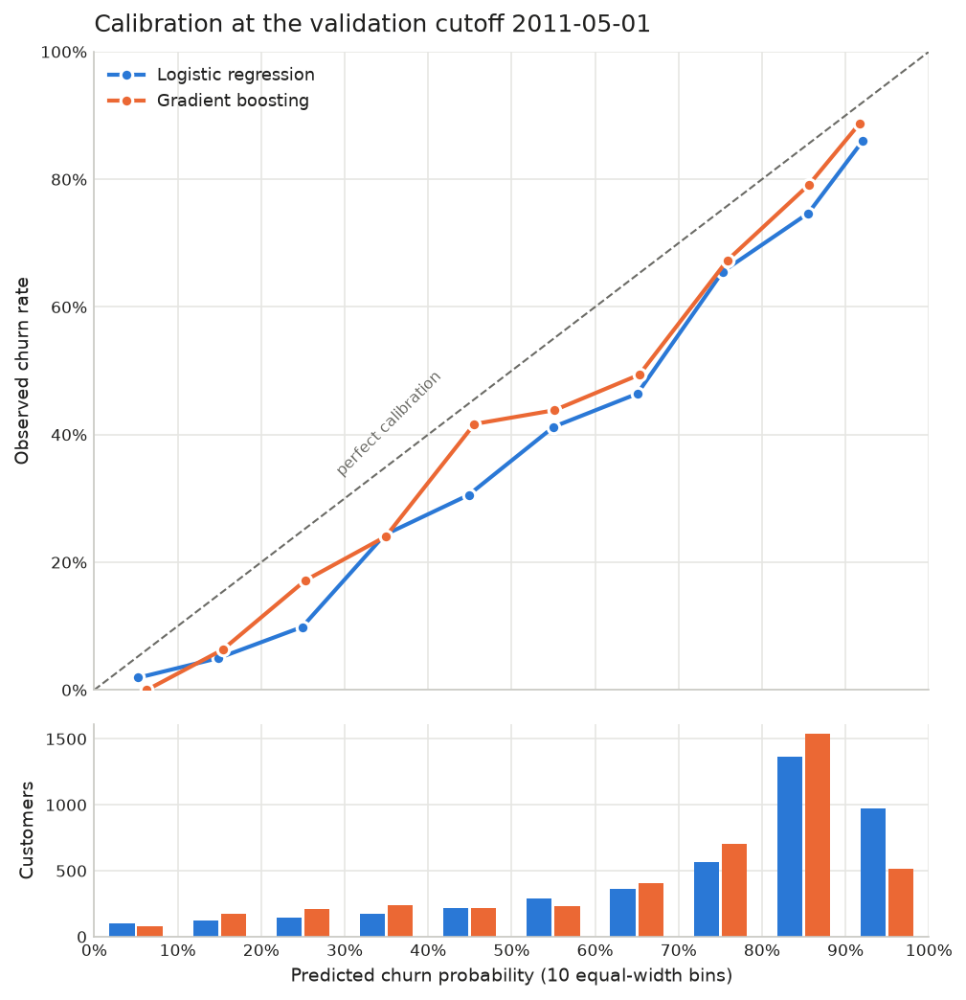

# C4: Models and validation

*Generated from `results/c4_validation_metrics.json` on 2026-10-13T16:30:26+00:00 (git cfc6b97adb307dfa3edfa1451bd2e0069be2e1c3,
uncommitted changes: True). Do not edit by hand; edit
`docs/templates/C4_models.md` and rerun `python -m churn.run_c4`.*

## What this step does

It builds three ways of spotting customers who are about to stop buying, and compares them on a
month the models did not learn from:

1. **A simple rule:** rank customers by days since their last purchase, longest first. A yes/no
   version ("churn if no purchase for more than X days") is reported alongside.
2. **Logistic regression:** each of the 21 features pushes the risk up or down by a fixed amount,
   after the features are put on a common scale.
3. **Gradient boosting** (scikit-learn `HistGradientBoostingClassifier`, version
   1.9.1): many small decision trees, each correcting the previous ones.

**The test cutoff (2011-09-01) was not read in this step.** All settings were chosen
on the validation cutoff, and the final models are frozen for a single test run in part B.

## How the models were tuned without touching the test

The test asks: trained on earlier months, how well does a model rank customers at a later month?
Tuning asks the same question one step earlier. The validation cutoff is
2011-05-01. A training cutoff may be used to fit models during tuning only if its
90-day outcome window ends on or before the validation cutoff, the same gap
rule the test uses, so no label used for fitting overlaps the validation period:

| Training cutoff | 90-day window ends | Used to fit during tuning | Validation cutoff |
|---|---|---|---|
| 2010-12-01 | 2011-03-01 | yes | no |
| 2011-01-01 | 2011-04-01 | yes | no |
| 2011-02-01 | 2011-05-02 | no | no |
| 2011-03-01 | 2011-05-30 | no | no |
| 2011-04-01 | 2011-06-30 | no | no |
| 2011-05-01 | 2011-07-30 | no | yes |

For each model, every candidate setting is fitted on the tuning cutoffs and scored on the
validation cutoff; the setting with the highest validation PR-AUC is kept. Then the chosen settings
are refitted on all six training cutoffs; those are the final models for the test.

Candidates (all in `config/model.yaml`, each with a reason):

- **Rule:** the ranking uses `recency_days` directly, so it has nothing to tune and all its
  ranking metrics below do not depend on X. X only sets the yes/no flag: chosen from
  10 values by the validation PR-AUC of the 1/0 flag. Chosen: `recency_days > 120`.
- **Logistic regression:** 3 ways of preparing the features. Chosen:
  `log_signed_log`. `log_signed_log` takes log(1 + x) of counts, days, averages and
  ratios that are never negative, and sign(x) x log(1 + |x|) of net revenue and trends, which can
  be negative. `log_clip` keeps log(1 + x) but clips the features that can be negative at their
  1st and 99th training percentiles. `standardise_only` does no reshaping. All three then put
  every feature on mean 0, standard deviation 1. Every value these steps learn (percentiles,
  means, standard deviations) comes from the training rows only (tested).
- **Gradient boosting:** 12 settings (learning rate x tree size x minimum leaf
  size), 200 trees each, no early stopping. Chosen: `learning_rate=0.03, max_leaf_nodes=8, min_samples_leaf=100`.

All seeds are fixed (`config/model.yaml`), so a rerun gives the same models and intervals.

## Churn base rates: training and validation side by side

The share of active customers who churn is not the same at every cutoff (NOTES.md), so a model's
probabilities are learned at one level and judged at another.

| Set | Cutoffs | Rows | Churned | Churn rate |
|---|---|---:|---:|---:|
| Tuning (fit) | 2010-12-01, 2011-01-01 | 8,438 | 5,645 | 66.9% |
| Validation (score) | 2011-05-01 | 4,317 | 2,647 | 61.3% |
| Final training (refit) | all 6 training cutoffs | 25,547 | 16,425 | 64.3% |

Per training cutoff:

| Cutoff | Customers | Churned | Churn rate |
|---|---:|---:|---:|
| 2010-12-01 | 4,236 | 2,831 | 66.8% |
| 2011-01-01 | 4,202 | 2,814 | 67.0% |
| 2011-02-01 | 4,218 | 2,760 | 65.4% |
| 2011-03-01 | 4,258 | 2,687 | 63.1% |
| 2011-04-01 | 4,316 | 2,686 | 62.2% |
| 2011-05-01 | 4,317 | 2,647 | 61.3% |

## Validation results

Scores on 2011-05-01 (4,317 active customers,
2,647 churned, base rate 61.3%),
from models fitted on the tuning cutoffs only. 95% intervals come from
1,000 bootstrap resamples of the validation customers; they show
sampling noise, not how results move from one month to another.

| Model | ROC-AUC (95% CI) | PR-AUC (95% CI) | Precision top 10% (95% CI) | Precision top 20% (95% CI) | Brier | Mean predicted |
|---|---|---|---|---|---|---|
| Rule (rank by recency) | 0.738 (0.723-0.753) | 0.794 (0.776-0.812) | 84.3% (81.0%-87.8%) | 84.2% (81.7%-86.6%) | n/a (not a probability) | n/a |
| Logistic regression | 0.787 (0.773-0.801) | 0.826 (0.809-0.843) | 89.1% (86.3%-92.1%) | 86.7% (84.3%-89.0%) | 0.188 | 71.9% |
| Gradient boosting | 0.789 (0.776-0.804) | 0.832 (0.816-0.848) | 89.6% (87.0%-92.8%) | 88.0% (85.9%-90.2%) | 0.181 | 69.1% |

How to read it: ROC-AUC is the chance that a random churner is scored above a random customer who
stays (0.5 = coin flip). PR-AUC summarises precision across all list lengths; a model that ranks
at random scores the base rate. Precision in the top 10% is the share of churners among the 10% of
customers with the highest scores, the group a retention campaign would contact first. Brier is
the mean squared gap between the probability and what happened (lower is better). Mean predicted
is the average churn probability, to compare with the base rate
(61.3%).

**Counts behind the top-10% and top-20% figures:**

| Model | Top 10%: customers | churners | recall | Top 20%: customers | churners | recall |
|---|---:|---|---:|---:|---|---:|
| Rule (rank by recency) | 432 | 364 | 13.8% | 864 | 727.3 | 27.5% |
| Logistic regression | 432 | 385 | 14.5% | 864 | 749 | 28.3% |
| Gradient boosting | 432 | 387 | 14.6% | 864 | 760 | 28.7% |

Customers tied at the cut-off score share the remaining places equally, which is why a count can
have a decimal (many customers share the same recency_days).

The yes/no flag `recency_days > 120` says yes for 2,183 customers
(50.6%); 79.5% of them churned, and it catches
65.5% of all churners.

**Caution:** these are the scores of the settings that won on this same month, so they are a little
optimistic. The test cutoff gives the honest number.

### Calibration (do predicted probabilities match what happened?)

On average the logistic regression predicts 71.9% and gradient
boosting 69.1%, against an observed 61.3%.
The models learned their probabilities on the tuning cutoffs, where the churn rate was
66.9%, so a gap in this direction is expected when the churn rate falls.
Ranking (AUC, precision in the top groups) does not depend on that level; the probabilities do.

| Model | Predicted bin | Customers | Mean predicted | Observed churn |
|---|---|---:|---:|---:|
| Logistic | 0%-10% | 104 | 5.3% | 1.9% |
| Logistic | 10%-20% | 120 | 14.9% | 5.0% |
| Logistic | 20%-30% | 142 | 24.9% | 9.9% |
| Logistic | 30%-40% | 177 | 34.8% | 24.3% |
| Logistic | 40%-50% | 216 | 44.9% | 30.6% |
| Logistic | 50%-60% | 291 | 55.1% | 41.2% |
| Logistic | 60%-70% | 362 | 65.1% | 46.4% |
| Logistic | 70%-80% | 566 | 75.3% | 65.5% |
| Logistic | 80%-90% | 1,363 | 85.5% | 74.7% |
| Logistic | 90%-100% | 976 | 92.0% | 86.0% |
| Boosting | 0%-10% | 81 | 6.3% | 0.0% |
| Boosting | 10%-20% | 174 | 15.4% | 6.3% |
| Boosting | 20%-30% | 210 | 25.3% | 17.1% |
| Boosting | 30%-40% | 237 | 34.9% | 24.1% |
| Boosting | 40%-50% | 216 | 45.5% | 41.7% |
| Boosting | 50%-60% | 235 | 55.1% | 43.8% |
| Boosting | 60%-70% | 409 | 65.3% | 49.4% |
| Boosting | 70%-80% | 701 | 75.9% | 67.3% |
| Boosting | 80%-90% | 1,536 | 85.6% | 79.2% |
| Boosting | 90%-100% | 518 | 91.7% | 88.8% |

The rule's score is a number of days, not a probability, so it has no Brier score or calibration table.

### Every candidate tried

| Model | Setting | Validation PR-AUC | ROC-AUC | Precision top 10% |
|---|---|---|---|---:|
| Rule (rank by recency) | recency_days > 30 | 0.677 | 0.621 | 68.5% |
| Rule (rank by recency) | recency_days > 45 | 0.699 | 0.655 | 71.6% |
| Rule (rank by recency) | recency_days > 60 | 0.711 | 0.672 | 73.8% |
| Rule (rank by recency) | recency_days > 75 | 0.724 | 0.688 | 76.2% |
| Rule (rank by recency) | recency_days > 90 | 0.728 | 0.691 | 77.4% |
| Rule (rank by recency) | recency_days > 105 | 0.731 | 0.694 | 78.8% |
| Rule (rank by recency) | recency_days > 120 | 0.732 | 0.694 | 79.5% |
| Rule (rank by recency) | recency_days > 150 | 0.728 | 0.683 | 80.9% |
| Rule (rank by recency) | recency_days > 180 | 0.700 | 0.636 | 83.2% |
| Rule (rank by recency) | recency_days > 240 | 0.657 | 0.566 | 84.6% |
| Logistic regression | standardise_only | 0.821 | 0.775 | 89.6% |
| Logistic regression | log_signed_log | 0.826 | 0.787 | 89.1% |
| Logistic regression | log_clip | 0.825 | 0.786 | 90.3% |
| Gradient boosting | learning_rate=0.03, max_leaf_nodes=8, min_samples_leaf=20 | 0.829 | 0.787 | 89.1% |
| Gradient boosting | learning_rate=0.03, max_leaf_nodes=8, min_samples_leaf=100 | 0.832 | 0.789 | 89.6% |
| Gradient boosting | learning_rate=0.03, max_leaf_nodes=8, min_samples_leaf=300 | 0.831 | 0.789 | 88.9% |
| Gradient boosting | learning_rate=0.03, max_leaf_nodes=31, min_samples_leaf=20 | 0.820 | 0.779 | 88.0% |
| Gradient boosting | learning_rate=0.03, max_leaf_nodes=31, min_samples_leaf=100 | 0.823 | 0.782 | 87.7% |
| Gradient boosting | learning_rate=0.03, max_leaf_nodes=31, min_samples_leaf=300 | 0.829 | 0.786 | 88.2% |
| Gradient boosting | learning_rate=0.1, max_leaf_nodes=8, min_samples_leaf=20 | 0.820 | 0.780 | 87.3% |
| Gradient boosting | learning_rate=0.1, max_leaf_nodes=8, min_samples_leaf=100 | 0.818 | 0.781 | 86.1% |
| Gradient boosting | learning_rate=0.1, max_leaf_nodes=8, min_samples_leaf=300 | 0.816 | 0.782 | 85.9% |
| Gradient boosting | learning_rate=0.1, max_leaf_nodes=31, min_samples_leaf=20 | 0.805 | 0.763 | 86.3% |
| Gradient boosting | learning_rate=0.1, max_leaf_nodes=31, min_samples_leaf=100 | 0.809 | 0.767 | 86.6% |
| Gradient boosting | learning_rate=0.1, max_leaf_nodes=31, min_samples_leaf=300 | 0.815 | 0.774 | 86.8% |

Files: `results/c4_validation_summary.csv` (all metrics with intervals),
`results/c4_validation_tuning.csv`, `results/c4_validation_calibration.csv`, and the frozen-model
manifest `results/c4_final_models.json` (chosen settings, training cutoffs and the sha256 of each
saved model file in `data/processed/models/`).

## Test results (part B)

> **NOT RUN YET.** This section stays empty until part B runs `python -m churn.run_c4_test` once,
> from a clean, committed working tree, with the frozen models above. That script writes
> `results/c4_test_metrics.json` (with the git SHA and data checksums) and refuses to run a second
> time. The test-cutoff metrics table, counts, calibration and base rate go here.
