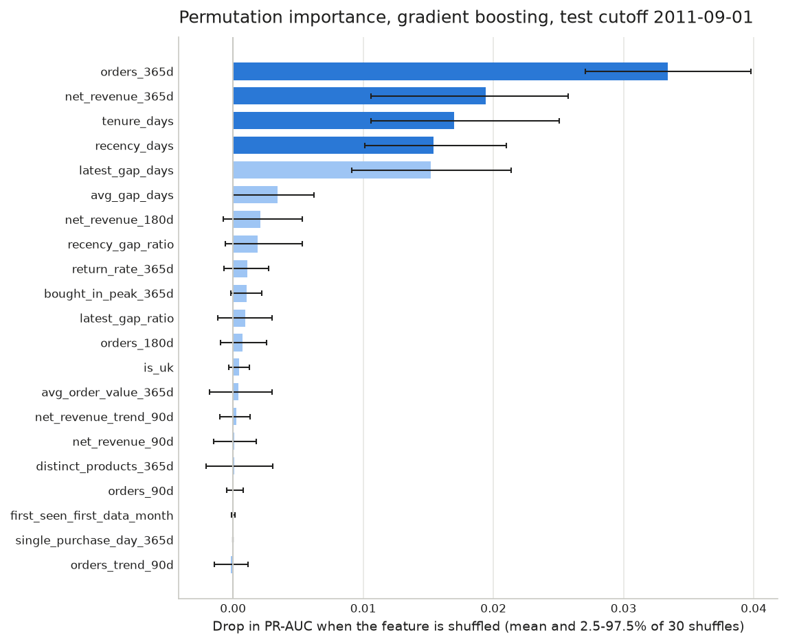

# C5: What drives churn, and what we would have done on 2011-09-01

*Generated from `results/c5_drivers.json` and `results/c5_business.json` on 2026-10-14T06:07:08+00:00
(git a7cacc02fe590d210f65b312e5d27ec6dc553d23, uncommitted changes: True). Do not edit by hand;
edit `docs/templates/C5_drivers_and_business.md` and rerun `python -m churn.run_c5`.*

## What this step does, and what it does not touch

1. **Drivers:** which features the main model (gradient boosting) relies on, and plain-language
   statements about how churn differs between groups of customers.
2. **Business layer:** revenue at risk and a costed retention campaign, as if we had run it on
   the test cutoff 2011-09-01 with the frozen model.

Guardrails:

- The frozen gradient boosting model (`gbm.joblib`, sha256 `2dfb635d852d480ad6c617432bea012d0d85285847b0affa3a0dcfe52a3ff146`) is
  only used to predict. Nothing is refitted, tuned or changed, and the one-shot test
  (`churn.run_c4_test`) is not run again. Before anything else, the run checks that the model
  hashes and the test snapshot's sha256 (`56afd2c32cf14fba86aac7c64c4aec83d0b69bcbf143667932871d3544f71f4f`) match the one-shot test
  record, and that the recomputed PR-AUC and mean probability equal the saved test results.
- Test-cutoff outcomes are used for two things only: permutation importance (it measures how
  much the model's test score drops; nothing is changed afterwards), and after-the-fact checks
  that are labelled as such. The campaign itself uses only what was known on 2011-09-01.
- Driver statements are computed on the 25,547 training rows (6 training cutoffs),
  never on the test cutoff.
- **All money figures are estimates under the assumptions in `config/business.yaml`**, not
  observed effects. Nothing here shows that an offer causes anyone to stay.

## Part 1: Drivers

### Permutation importance (test cutoff, held-out data)

For each feature, its values are shuffled across the 4,323 test customers and the drop
in the model's PR-AUC is measured (baseline PR-AUC 0.746),
30 times with seed 20111201. A larger drop means the model
leans on that feature more.

| Rank | Feature | Mean drop in PR-AUC | 2.5-97.5% of shuffles | Definition |
|---:|---|---|---|---|
| 1 | `orders_365d` | 0.0334 | 0.0271 to 0.0398 | Purchase events in the 365 days before the cutoff. |
| 2 | `net_revenue_365d` | 0.0194 | 0.0106 to 0.0258 | Net value (£) of all lines in the 365 days before the cutoff (trailing 12-month revenue). |
| 3 | `tenure_days` | 0.0170 | 0.0106 to 0.0251 | Whole days from the first purchase day in the data to the cutoff date. |
| 4 | `recency_days` | 0.0154 | 0.0101 to 0.0210 | Whole days from the last purchase day to the cutoff date (1 = bought the day before). |
| 5 | `latest_gap_days` | 0.0152 | 0.0091 to 0.0214 | Days between the last two purchase days in the last 365 days (365 if only one purchase day). |
| 6 | `avg_gap_days` | 0.0034 | -0.0000 to 0.0062 | Mean days between consecutive purchase days in the last 365 days (365 if only one purchase day). |
| 7 | `net_revenue_180d` | 0.0021 | -0.0007 to 0.0053 | Net value (£) of all lines in the 180 days before the cutoff. |
| 8 | `recency_gap_ratio` | 0.0019 | -0.0006 to 0.0053 | recency_days / avg_gap_days (above 1: already waiting longer than the usual gap). |
| 9 | `return_rate_365d` | 0.0011 | -0.0007 to 0.0027 | Value returned / value bought in the last 365 days; same-day full cancellations count on neither side. Can exceed 1 when earlier purchases are returned. |
| 10 | `bought_in_peak_365d` | 0.0010 | -0.0002 to 0.0022 | 1 if the customer bought in the November or December inside the last 365 days. |
| 11 | `latest_gap_ratio` | 0.0009 | -0.0012 to 0.0030 | latest_gap_days / avg_gap_days (above 1: the last gap was longer than usual). |
| 12 | `orders_180d` | 0.0007 | -0.0009 to 0.0026 | Purchase events in the 180 days before the cutoff. |
| 13 | `is_uk` | 0.0004 | -0.0003 to 0.0013 | 1 if the country on the customer's latest line before the cutoff is the United Kingdom. |
| 14 | `avg_order_value_365d` | 0.0004 | -0.0018 to 0.0030 | Value (£) of purchase events in the last 365 days divided by their number. |
| 15 | `net_revenue_trend_90d` | 0.0002 | -0.0010 to 0.0013 | Net value (£) in the last 90 days minus net value in the 90 days before them. |
| 16 | `net_revenue_90d` | 0.0001 | -0.0015 to 0.0018 | Net value (£) of all lines, purchases minus returns, in the 90 days before the cutoff. |
| 17 | `distinct_products_365d` | 0.0001 | -0.0021 to 0.0031 | Distinct stock codes (upper-cased, stripped) in purchase events in the last 365 days. |
| 18 | `orders_90d` | 0.0000 | -0.0005 to 0.0008 | Purchase events in the 90 days before the cutoff. |
| 19 | `first_seen_first_data_month` | 0.0000 | -0.0001 to 0.0002 | 1 if the first purchase is in the first data month (Dec 2009): tenure is a lower bound. |
| 20 | `single_purchase_day_365d` | 0.0000 | 0.0000 to 0.0000 | 1 if the customer bought on only one day in the last 365 days (gap features then use fill values). |
| 21 | `orders_trend_90d` | -0.0002 | -0.0014 to 0.0012 | Purchase events in the last 90 days minus those in the 90 days before them. |

How to read it:

- The range is the spread over the 30 shuffles. It shows shuffle noise,
  not sampling noise or month-to-month change. A range that includes 0 means "no clear effect".
- **Related features share credit.** Shuffling one of several features that carry the same
  information hurts little, because the model can still use the others. Examples: the
  90/180/365-day order and revenue windows; recency and the gap features; and
  `single_purchase_day_365d`, which says almost the same as `orders_365d` = 1. A low rank
  therefore does not mean "irrelevant to churn". It means the model does not need this feature
  once it has the others.
- Ranks 4 and 5 are practically tied (`recency_days` 0.0154 vs `latest_gap_days` 0.0152). "Top 4" is a reporting choice, not a sharp line.
- This explains the model, not the customers. It is not a causal ranking.

The top 4 drivers: `orders_365d`, `net_revenue_365d`, `tenure_days`, `recency_days`.

### Partial dependence of the top 4 drivers

Each curve sets one feature to each grid value for every test customer and averages the
predicted churn probability, holding the customers' other features as they are. Grid: 20 points
from the 5th to the 95th percentile of the test customers' values.

| Feature | Lowest grid value | Average predicted churn there | Highest grid value | Average predicted churn there |
|---|---|---:|---|---:|
| `orders_365d` | 1 | 70.3% | 13 | 41.8% |
| `net_revenue_365d` | 107 | 68.7% | 5,580 | 60.4% |
| `tenure_days` | 65 | 67.2% | 637 | 61.9% |
| `recency_days` | 8 | 59.3% | 334 | 66.7% |

The probabilities are on the model's own scale, which runs too high at the test cutoff
(docs/C4_models.md). Read the direction and shape, not the level. Partial dependence
averages over customers whose other features may not fit the set value (for example, a long
tenure next to a short recency), so it is a summary of the model, not of real customers.

### Plain-language statements (training cutoffs only)

On the 25,547 customer-cutoff rows of the six training cutoffs
(2010-12-01 to 2011-05-01; a customer can appear at several cutoffs):

- Customers who have waited more than twice their usual gap between purchases churned **65.8%** of the time vs **64.0%** for everyone else (ratio 1.03; 4,303 of 25,547 customer-cutoff rows; 62%-72% vs 60%-67% across the 6 cutoffs).
- Customers who have not bought for more than 90 days churned **78.7%** of the time vs **50.4%** for everyone else (ratio 1.56; 12,518 of 25,547 customer-cutoff rows; 76%-85% vs 41%-58% across the 6 cutoffs). **(top-4 driver)**
- Customers who bought on only one day in the past year churned **84.8%** of the time vs **52.6%** for everyone else (ratio 1.61; 9,309 of 25,547 customer-cutoff rows; 82%-88% vs 48%-56% across the 6 cutoffs).
- Customers who placed 10 or more orders in the past year churned **12.9%** of the time vs **69.0%** for everyone else (ratio 0.19; 2,150 of 25,547 customer-cutoff rows; 10%-16% vs 66%-72% across the 6 cutoffs). **(top-4 driver)**
- Customers who ordered less in the last 90 days than in the 90 days before churned **62.0%** of the time vs **65.6%** for everyone else (ratio 0.94; 9,430 of 25,547 customer-cutoff rows; 57%-67% vs 64%-67% across the 6 cutoffs).
- Customers who did not buy in the last November-December peak churned **75.3%** of the time vs **51.7%** for everyone else (ratio 1.46; 13,633 of 25,547 customer-cutoff rows; 70%-80% vs 50%-54% across the 6 cutoffs).
- Customers who bought 50 or more different products in the past year churned **46.0%** of the time vs **76.1%** for everyone else (ratio 0.61; 10,007 of 25,547 customer-cutoff rows; 42%-49% vs 73%-79% across the 6 cutoffs).
- Customers who first bought less than 180 days before the cutoff churned **74.1%** of the time vs **60.4%** for everyone else (ratio 1.23; 7,251 of 25,547 customer-cutoff rows; 68%-78% vs 59%-62% across the 6 cutoffs). **(top-4 driver)**
- Customers who spent less than £300 in the past 12 months churned **85.3%** of the time vs **57.1%** for everyone else (ratio 1.49; 6,531 of 25,547 customer-cutoff rows; 83%-88% vs 53%-60% across the 6 cutoffs). **(top-4 driver)** *(statement added after the ranking)*
- Customers who bought on 2+ days in the past year and have waited more than twice their usual gap churned **65.8%** of the time vs **47.8%** for everyone else (ratio 1.38; 4,303 of 16,238 customer-cutoff rows; 62%-72% vs 39%-52% across the 6 cutoffs). *(statement added after the ranking)*
- Customers who bought on 2+ days in the past year and whose last gap between purchases was over 90 days churned **64.3%** of the time vs **47.4%** for everyone else (ratio 1.36; 4,934 of 16,238 customer-cutoff rows; 55%-72% vs 45%-50% across the 6 cutoffs). *(statement added after the ranking)*

| Group | Condition | Driver rank | Share of rows | Rows in group | Churn in group | Churn, rest | Ratio | Group, per cutoff | Rest, per cutoff |
|---|---|---:|---:|---:|---:|---:|---|---|---|
| Customers who have waited more than twice their usual gap between purchases | `recency_gap_ratio > 2` | 8 | 16.8% | 4,303 | 65.8% | 64.0% | 1.03 | 62%-72% | 60%-67% |
| Customers who have not bought for more than 90 days | `recency_days > 90` | 4 | 49.0% | 12,518 | 78.7% | 50.4% | 1.56 | 76%-85% | 41%-58% |
| Customers who bought on only one day in the past year | `single_purchase_day_365d == 1` | 20 | 36.4% | 9,309 | 84.8% | 52.6% | 1.61 | 82%-88% | 48%-56% |
| Customers who placed 10 or more orders in the past year | `orders_365d >= 10` | 1 | 8.4% | 2,150 | 12.9% | 69.0% | 0.19 | 10%-16% | 66%-72% |
| Customers who ordered less in the last 90 days than in the 90 days before | `orders_trend_90d < 0` | 21 | 36.9% | 9,430 | 62.0% | 65.6% | 0.94 | 57%-67% | 64%-67% |
| Customers who did not buy in the last November-December peak | `bought_in_peak_365d == 0` | 10 | 53.4% | 13,633 | 75.3% | 51.7% | 1.46 | 70%-80% | 50%-54% |
| Customers who bought 50 or more different products in the past year | `distinct_products_365d >= 50` | 17 | 39.2% | 10,007 | 46.0% | 76.1% | 0.61 | 42%-49% | 73%-79% |
| Customers who first bought less than 180 days before the cutoff | `tenure_days < 180` | 3 | 28.4% | 7,251 | 74.1% | 60.4% | 1.23 | 68%-78% | 59%-62% |
| Customers who spent less than £300 in the past 12 months | `net_revenue_365d < 300` | 2 | 25.6% | 6,531 | 85.3% | 57.1% | 1.49 | 83%-88% | 53%-60% |
| Customers who bought on 2+ days in the past year and have waited more than twice their usual gap | `recency_gap_ratio > 2 among single_purchase_day_365d == 0` | 8 | 26.5% | 4,303 | 65.8% | 47.8% | 1.38 | 62%-72% | 39%-52% |
| Customers who bought on 2+ days in the past year and whose last gap between purchases was over 90 days | `latest_gap_days > 90 among single_purchase_day_365d == 0` | 5 | 30.4% | 4,934 | 64.3% | 47.4% | 1.36 | 55%-72% | 45%-50% |

"Per cutoff" gives the lowest and highest churn rate over the six cutoffs, to show the gap is
stable from month to month. These are associations: for example, frequent buyers churn less,
but nothing here says that making someone order more would keep them.

Every top-4 driver has at least one statement above. Statements marked "added after the ranking" were defined after the
importance ranking above had been computed (`config/drivers.yaml`). They use training rows only,
like the rest.

**On the "twice the usual gap" statement:** over all rows it barely separates churners (the
first statement). The comparison group includes the one-day buyers, whose gap is filled with
365 days, so their ratio is small even though they churn most. Among repeat buyers only, the
same statement does separate them.

## Part 2: Business layer on 2011-09-01

### Assumptions (`config/business.yaml`)

| Assumption | Central | Scenarios | Source |
|---|---:|---|---|
| Gross margin | 30.0% | 20%, 30%, 40% | Not in the data; PROJECT_PLAN.md Section 6 (TO VERIFY) |
| Save rate (share of contacted would-be churners kept) | 10.0% | 5%, 10%, 20% | Not observable here; PROJECT_PLAN.md Section 6 (TO VERIFY) |
| Offer cost per contacted customer | £15 | £5, £15, £40 | Judgement (TO VERIFY), see below |
| Customer value | trailing 12-month net revenue, floored at £0 | | `net_revenue_365d` |

Offer cost: £15 is roughly a 5% discount on a typical order plus an emailed contact. The median
order value at the training cutoffs is £285. The cost is counted for every
contacted customer, which is cautious, since some never use the offer. £5 = an email with a small
voucher; £40 = a 10% discount plus a staff phone call.

Customer value at the test cutoff: 4,323 active customers, total 12-month net revenue
£7,830,998, median £625. 3 customers
had negative net revenue (returns of earlier purchases, £9,907 in total) and
count as £0.

The value assumes a customer who is kept goes on buying at their last-12-month level for the next
12 months. That is generous: "churned" here means no purchase in 90 days, and some of those
customers come back later anyway (TO VERIFY).

### Revenue at risk

Revenue at risk = sum over customers of p(churn) x 12-month value. The C4 test showed the model's
probabilities run too high, so it is shown two ways:

| Probabilities | Mean p(churn) | Revenue at risk (estimate) | Share of 12-month revenue |
|---|---:|---|---:|
| (a) Model probabilities as they are | 64.1% | £2,316,268 | 29.6% |
| (b) Rescaled to the latest known churn rate | 63.4% | £2,276,543 | 29.1% |

**Why (b) uses only information available on the day.** On 2011-09-01, the most recent
cutoff whose 90-day outcome was complete was 2011-06-01: its window ended
2011-08-30, before the decision day. Its churn rate was
63.4% (2,741 of 4,324). The code
checks that this window ends on or before the decision day and that no later cutoff qualifies
(2011-07-01's window was still open). Version (b) adds one constant (-0.040) to every
customer's log-odds so the average probability equals that rate. Ranking is unchanged. Only that
one overall rate is used: no customer labels and no refitting.

**What this shows.** The rate known on the day (63.4%) was close to the
model's own average (64.1%), so rescaling barely changes anything. The
drop to the 50.5% actually seen at the test cutoff was not visible
on 2011-09-01 (see the seasonal hypothesis in docs/C4_models.md).

*After the fact only:* the customers who did churn held £1,581,929 of 12-month
revenue (20.2% of the total), less than either
estimate. Both versions overstate the revenue at risk at this cutoff.

### Whom to contact

Expected benefit of contacting a customer = p(churn) x save rate x margin x 12-month value - offer
cost. Customers are ranked by it, and the best campaign contacts everyone with a positive expected
benefit. Within a scenario that is the same as: **contact a customer if p(churn) x value is above
offer cost / (save rate x margin)**. In the central case that bar is £500 of
expected revenue at risk. Margin and save rate enter only as a product, so for example 20% margin
x 10% save rate gives the same answer as 40% x 5%.

All 27 scenarios (central case in bold; (a) model probabilities, (b) rescaled):

| Margin | Save rate | Offer cost | Contact if p x value above | (a) best size | (a) net benefit | (b) best size | (b) net benefit |
|---|---|---|---|---|---|---|---|
| 20% | 5% | £5 | £500 | 1,612 | £7,838 | 1,567 | £7,540 |
| 20% | 5% | £15 | £1,500 | 157 | £2,369 | 155 | £2,282 |
| 20% | 5% | £40 | £4,000 | 22 | £989 | 21 | £962 |
| 20% | 10% | £5 | £250 | 3,086 | £27,118 | 3,060 | £26,358 |
| 20% | 10% | £15 | £750 | 782 | £9,941 | 748 | £9,533 |
| 20% | 10% | £40 | £2,000 | 85 | £3,581 | 79 | £3,461 |
| 20% | 20% | £5 | £125 | 3,881 | £71,776 | 3,874 | £70,196 |
| 20% | 20% | £15 | £375 | 2,253 | £40,973 | 2,219 | £39,596 |
| 20% | 20% | £40 | £1,000 | 385 | £14,373 | 364 | £13,820 |
| 30% | 5% | £5 | £333 | 2,515 | £16,852 | 2,482 | £16,315 |
| 30% | 5% | £15 | £1,000 | 385 | £5,390 | 364 | £5,183 |
| 30% | 5% | £40 | £2,667 | 43 | £2,100 | 42 | £2,037 |
| 30% | 10% | £5 | £167 | 3,648 | £49,125 | 3,639 | £47,948 |
| **30%** | **10%** | **£15** | **£500** | **1,612** | **£23,513** | **1,567** | **£22,621** |
| 30% | 10% | £40 | £1,333 | 201 | £8,000 | 197 | £7,707 |
| 30% | 20% | £5 | £83 | 4,140 | £117,724 | 4,139 | £115,344 |
| 30% | 20% | £15 | £250 | 3,086 | £81,355 | 3,060 | £79,073 |
| 30% | 20% | £40 | £667 | 998 | £34,250 | 963 | £32,849 |
| 40% | 5% | £5 | £250 | 3,086 | £27,118 | 3,060 | £26,358 |
| 40% | 5% | £15 | £750 | 782 | £9,941 | 748 | £9,533 |
| 40% | 5% | £40 | £2,000 | 85 | £3,581 | 79 | £3,461 |
| 40% | 10% | £5 | £125 | 3,881 | £71,776 | 3,874 | £70,196 |
| 40% | 10% | £15 | £375 | 2,253 | £40,973 | 2,219 | £39,596 |
| 40% | 10% | £40 | £1,000 | 385 | £14,373 | 364 | £13,820 |
| 40% | 20% | £5 | £62 | 4,212 | £163,928 | 4,212 | £160,752 |
| 40% | 20% | £15 | £187 | 3,520 | £125,019 | 3,514 | £121,893 |
| 40% | 20% | £40 | £500 | 1,612 | £62,700 | 1,567 | £60,324 |

The best campaign size depends mostly on the assumptions: from
21 to 4,212 customers under (b). The model ranks customers;
the assumptions decide how far down the list it pays to go.

The line is the central case with rescaled probabilities (b). The band is the lowest to highest
total over all 27 scenarios at each campaign size, each scenario using its own ranking. Every
curve rises while the next customer's expected benefit is positive and falls after that.

**Central case, "what we would have done on 2011-09-01" (b):** contact
**1,567** customers. Offer cost £23,505; expected revenue kept
£153,754; expected net benefit (margin on revenue kept minus cost)
**£22,621**, an estimate under the assumptions above. With (a) the answer is
1,612 customers and £23,513.

**After-the-fact check (not available on the day):** of the 1,567 customers
chosen in the central case (b), **562 actually churned
(35.9%)**. Their average predicted probability (b) was
51.9%, and the test base rate was 50.5%.
The list leans towards high-value customers: the chosen customers hold £5,673,143
of the £7,830,998 total. The same number of customers taken by p(churn) alone would
have held 1,166 churners, so ranking by p x value trades
churners for value. Swapping each chosen
customer's predicted probability for what actually happened, with the same assumptions, gives a
net benefit of £7,473 instead of £22,621. That is
still positive under these assumptions, but the save rate and margin are untested.

### Limitations

- Save rate, margin and offer cost are assumptions, not measurements. Only a controlled campaign
  (contact a random half of the chosen list) could measure the save rate.
- Probabilities ran too high at this cutoff, and the on-the-day rescaling could not see the drop.
- "Churned" means no purchase in 90 days, not lost for good, while value counts 12 months.
- Customers are small businesses of very different sizes. A few large accounts weigh heavily in
  every £ total.
- Old data (2009-2011): the method transfers; the numbers describe this retailer only.

Files: `results/c5_drivers.json`, `results/c5_permutation_importance.csv`,
`results/c5_partial_dependence.csv`, `results/c5_driver_statements.csv`,
`results/c5_business.json`, `results/c5_campaign_scenarios.csv` (all 27 scenarios x 2 versions,
with after-the-fact columns), `results/c5_campaign_curve.csv`, and the three figures in
`results/figures/`.
