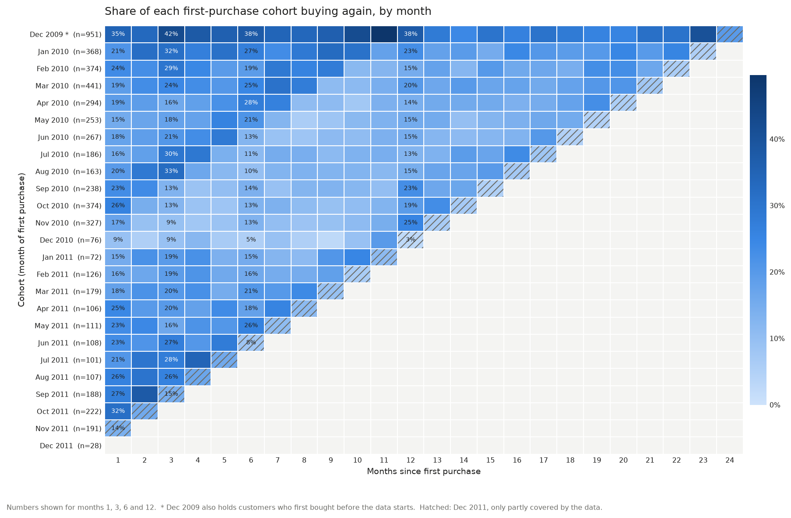
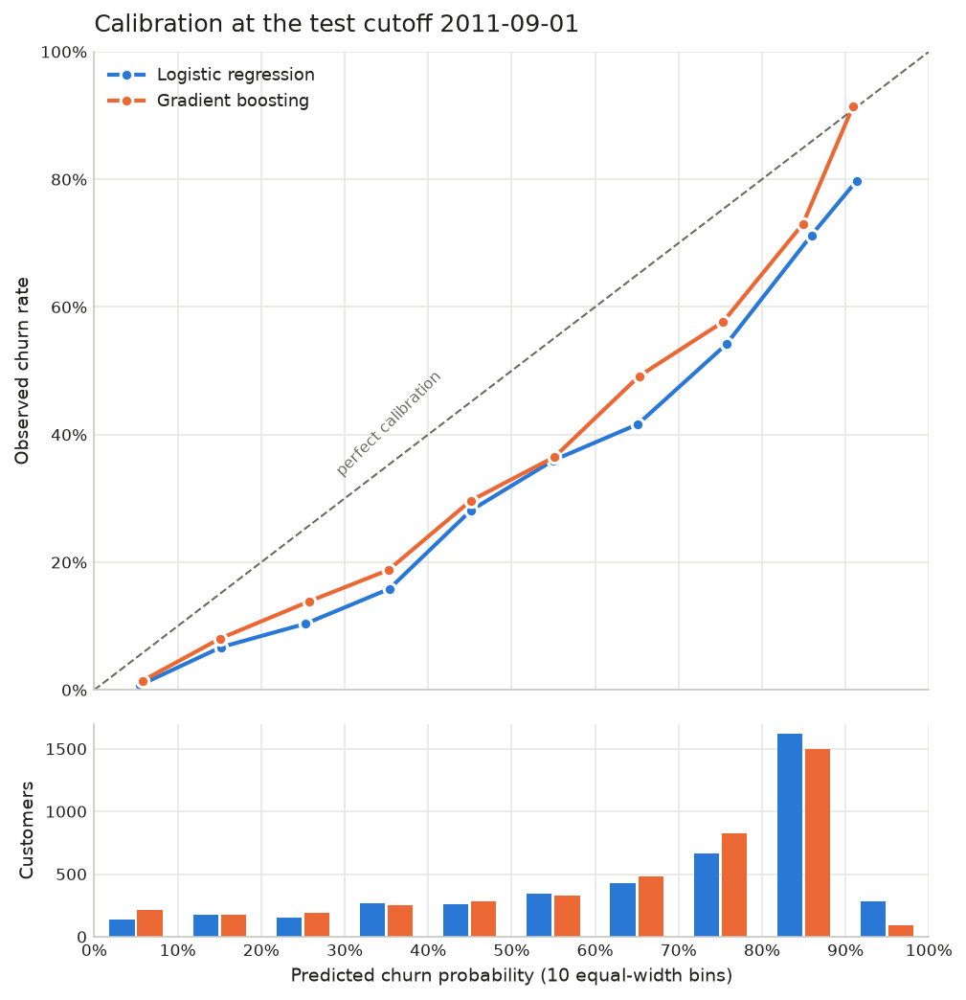
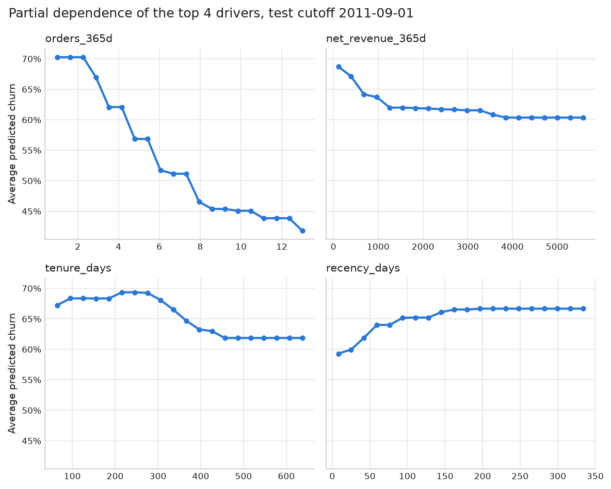
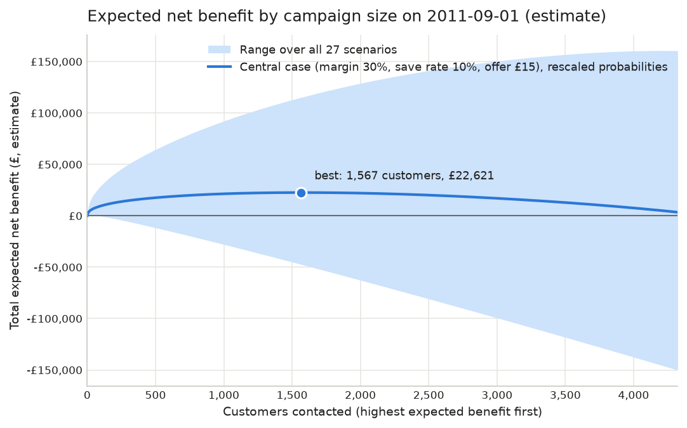
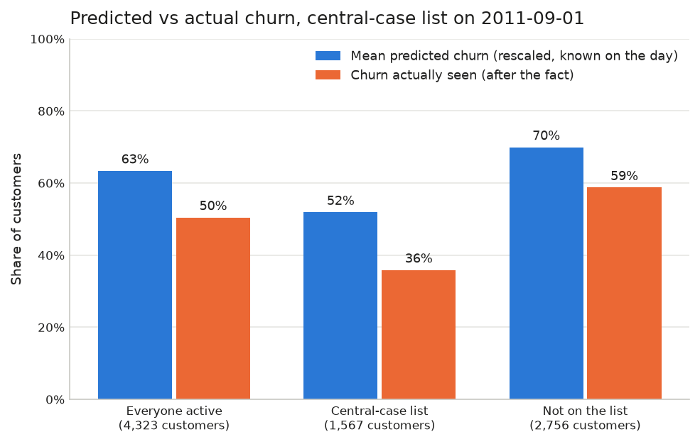

# Customer churn and retention: findings report

**UK online retailer, transactions December 2009 to December 2011 (UCI Online Retail II)**
Author: Aradhya Chandra

*Generated by `python -m churn.run_c6` on 2026-10-14T06:41:45+00:00 (git 7845612a2e7fa9a68fc77376e66111c773d7aca3,
uncommitted changes: True) from the saved files in `results/`. Do not edit
by hand; edit `docs/templates/REPORT.md` and rerun. Every number below comes from a saved result.
Money figures are estimates under stated assumptions, not observed effects.*

---

## 1. Summary

The retailer loses many of its customers in any given quarter, and a model can tell in advance
which ones are most at risk. It ranks them clearly better than a simple "days since last purchase"
rule. A retention offer pays off under the central assumptions, but the money answer depends far
more on those assumptions (margin, how many customers an offer keeps, offer cost) than on the
model.

- **Churn is high and fell over time.** Of the 4,323 customers active on 2011-09-01,
  2,181 (50.5%) bought nothing in the next 90 days. At the six earlier
  training cutoffs the rate was 61.3% to 67.0%.
- **The model finds churners out of time.** On the untouched test month, gradient boosting reached
  a PR-AUC of 0.746 (0.726 to 0.767) against a base rate of 50.5%. Of its top 10% of customers,
  83.1% (360 of 433) churned, against 73.7% (319.1 of 433) for the recency rule. Boosting beats the rule.
  Boosting vs logistic regression is not settled.
- **Its probabilities run too high.** Boosting predicted 64.1% churn on average against
  50.5% seen, so its ranking is useful but its levels are not.
- **The strongest signals** are how often a customer ordered in the past year, how much they spent,
  how long they have been a customer and how long since their last purchase.
- **Central-case plan (estimate):** contact 1,567 customers at £15 each, for an
  expected net benefit of £22,621. Any size from 812 to 2,453 gets
  within 90% of that, while across all 27 assumption scenarios the best size runs from
  21 to 4,212 customers.
- **After the fact, the plan looks weaker.** Only 35.9% of the chosen customers churned,
  against 51.9% predicted. Recomputing the plan with what actually happened gives
  £7,473 instead of £22,621. It is still positive, but only under assumptions
  nobody has tested.

**Recommendation.** Use the score to rank customers, not to forecast how many will leave. Before
a full rollout, run a small controlled campaign (offer to a random half of the chosen list) to
measure the save rate. That one number decides how far down the list it pays to go.

## 2. The problem and the approach

The retailer sells giftware online, mostly to small businesses. It wants to know how many
customers it loses and when, which active customers are likely to stop buying, why, and whether
a retention offer would pay for itself.

Definitions (`config/churn.yaml`):

- **Active** at a cutoff date: at least one purchase in the 365 days before it.
- **Churned**: an active customer with no purchase in the 90 days after the cutoff. 90 days is a
  choice. At 2011-05-01, a 60-day window gives 68.1% churn, 90 days 61.3% and
  120 days 57.5%.
- **Snapshots**: features use only data before the cutoff, and the label only the 90 days after.
  A test proves this for every feature.
- **Out-of-time test**: models are trained on six monthly cutoffs (2010-12-01 to 2011-05-01),
  tuned on the last of them, then frozen and scored **once** on 2011-09-01, a later month they
  never saw.

## 3. Data and cleaning

The raw file has 1,067,371 invoice lines from 2009-12-01 to 2011-12-09
(sha256 `bcbe73b35f5b7babf197fb0cb983a11f5d9ff929078d4aa53d171b1f2df2e980`). The two yearly sheets overlap: 22,523 lines appear in both
and are counted once. After cleaning, 794,183 lines and 5,875 customers remain.

| Cleaning step (in order) | Rows removed | Rows left | Net value removed |
|---|---:|---:|---|
| Line in the later sheet identical to a line in the earlier sheet | 22,523 | 1,044,848 | £377,488 |
| Exact duplicate line within one sheet (first copy kept) | 11,812 | 1,033,036 | £54,228 |
| Price is zero or negative | 6,019 | 1,027,017 | -£158,676 |
| Stock code is a non-product code listed in config | 5,745 | 1,021,272 | £86,811 |
| No Customer ID | 227,089 | 794,183 | £2,568,806 |

- The largest cut is lines without a Customer ID (227,089 lines, £2,568,806
  net). They cannot be tied to a customer.
- Returns are kept and netted against purchases, but a return is not a purchase.
  102 invoices cancelled in full by the same customer on the same day are
  not counted as purchases. 24 customers with only returns are left out.
- Full detail: `docs/C1_data_and_cleaning.md` and `docs/C2_cohorts_and_churn.md`.

## 4. Cohorts and the churn picture

Each row is the month of a customer's first purchase. Each cell is the share of that cohort buying
again *k* months later. Typical cohorts (median over cohorts, leaving out December 2009, whose
951 customers include buyers from before the data starts, and the partly covered
last month):

| Months after first purchase | Median share buying again | Lowest to highest cohort | Cohorts |
|---|---:|---|---:|
| Month 1 | 20.2% | 9% to 32% | 22 |
| Month 3 | 20.0% | 9% to 33% | 20 |
| Month 6 | 15.9% | 5% to 28% | 17 |
| Month 12 | 15.4% | 13% to 25% | 11 |

Most new customers do not come back in any given month. The December 2009 group, which includes
long-standing customers, is more loyal: 34.9% bought again one month later and
37.6% twelve months later, against medians of 20.2% and 15.4%.

Churn at each cutoff used by the models (the last column matters for Section 5):

| Cutoff | Role | Active customers | Churned | Churn rate | Days of the 90-day window in Sep-Nov |
|---|---|---:|---:|---:|---:|
| 2010-12-01 | training | 4,236 | 2,831 | 66.8% | 0 |
| 2011-01-01 | training | 4,202 | 2,814 | 67.0% | 0 |
| 2011-02-01 | training | 4,218 | 2,760 | 65.4% | 0 |
| 2011-03-01 | training | 4,258 | 2,687 | 63.1% | 0 |
| 2011-04-01 | training | 4,316 | 2,686 | 62.2% | 0 |
| 2011-05-01 | training | 4,317 | 2,647 | 61.3% | 0 |
| 2011-06-01 | not used | 4,324 | 2,741 | 63.4% | 0 |
| 2011-07-01 | not used | 4,313 | 2,647 | 61.4% | 28 |
| 2011-08-01 | not used | 4,325 | 2,461 | 56.9% | 59 |
| 2011-09-01 | test | 4,323 | 2,181 | 50.5% | 90 |

## 5. How well the model works, out of time

Three models, all chosen on training data only (`docs/C4_models.md`):

- **Recency rule**: rank customers by days since their last purchase (the baseline a manager
  could use without a model; as a yes/no flag, "over 120 days").
- **Logistic regression** on 21 features.
- **Gradient boosting** on the same 21 features (the main model).

Base rates differ between the sets, so every score should be read against its own base rate:

| Set | Customers | Churned | Churn rate |
|---|---:|---:|---:|
| Training (6 cutoffs, 2010-12-01 to 2011-05-01) | 25,547 | 16,425 | 64.3% |
| Validation (2011-05-01) | 4,317 | 2,647 | 61.3% |
| Test (2011-09-01), touched once | 4,323 | 2,181 | 50.5% |

| Model | Validation PR-AUC (95% CI) | Test PR-AUC (95% CI) | Test ROC-AUC (95% CI) | Test precision, top 10% | Test precision, top 20% | Test mean predicted |
|---|---|---|---|---|---|---|
| Recency rule | 0.794 (0.776 to 0.812) | 0.679 (0.657 to 0.701) | 0.708 (0.692 to 0.723) | 73.7% (319.1 of 433) | 71.7% (619.8 of 865) |  |
| Logistic regression | 0.826 (0.809 to 0.843) | 0.730 (0.709 to 0.753) | 0.769 (0.755 to 0.783) | 79.2% (343 of 433) | 76.2% (659 of 865) | 67.1% |
| Gradient boosting | 0.832 (0.816 to 0.848) | 0.746 (0.726 to 0.767) | 0.772 (0.758 to 0.786) | 83.1% (360 of 433) | 78.3% (677 of 865) | 64.1% |

Precision is shown with counts: "83.1% (360 of 433)" means that many of the top-scored customers churned.
The rule's counts can be fractional because customers with the same recency share the last places
equally. The 95% intervals come from resampling customers (1,000 times).

- Gradient boosting beats the recency rule: the 95% intervals of PR-AUC, precision in the top 10%, precision in the top 20% do not overlap.
- Gradient boosting vs logistic regression is not settled: their 95% intervals overlap on PR-AUC, precision in the top 10%, precision in the top 20%.
- Logistic regression vs the recency rule is not settled: their 95% intervals overlap on precision in the top 10%, precision in the top 20%.
- Every model scored lower on the test month than on validation, in part because there were fewer
  churners to find (50.5% vs 61.3%).

**Probabilities run high.** Mean predicted churn was 64.1% for boosting
(13.6 points above the 50.5% seen) and 67.1% for logistic regression
(16.6 points). The models learnt on months with 64.3% churn.

**Why test churn was lower: a hypothesis, TO VERIFY.** The test window (September to November)
lies entirely in the pre-Christmas buying season (90 of its 90 days), while the
training windows have 0 days in those months. Churn falls month by
month as the window moves into autumn (table above). That fits a seasonal effect, but churn was
already drifting down during the training months, and the data hold only one autumn with a full
year of history, so trend and season cannot be separated.

## 6. What drives churn

Permutation importance on the test month: shuffle one feature and measure how much the model's
PR-AUC drops. The top six:

| Rank | Feature | Drop in PR-AUC | Spread over shuffles | Meaning |
|---:|---|---|---|---|
| 1 | `orders_365d` | 0.0334 | 0.0271 to 0.0398 | Purchase events in the 365 days before the cutoff. |
| 2 | `net_revenue_365d` | 0.0194 | 0.0106 to 0.0258 | Net value (£) of all lines in the 365 days before the cutoff (trailing 12-month revenue). |
| 3 | `tenure_days` | 0.0170 | 0.0106 to 0.0251 | Whole days from the first purchase day in the data to the cutoff date. |
| 4 | `recency_days` | 0.0154 | 0.0101 to 0.0210 | Whole days from the last purchase day to the cutoff date (1 = bought the day before). |
| 5 | `latest_gap_days` | 0.0152 | 0.0091 to 0.0214 | Days between the last two purchase days in the last 365 days (365 if only one purchase day). |
| 6 | `avg_gap_days` | 0.0034 | -0.0000 to 0.0062 | Mean days between consecutive purchase days in the last 365 days (365 if only one purchase day). |

Related features share credit (order and revenue windows, recency and gaps), and ranks 4 and 5 are
tied within noise (`recency_days` 0.0154 vs `latest_gap_days` 0.0152). This explains the model, not the customers: it is not a causal
ranking.

In plain words, on the 25,547 customer-cutoff rows of the six training cutoffs, for
groups that match the top drivers:

| Group (training rows) | Driver rank | Rows in group | Churn in group | Churn, everyone else | Ratio | Added after the ranking |
|---|---:|---:|---:|---:|---|---|
| Customers who have not bought for more than 90 days | 4 | 12,518 | 78.7% | 50.4% | 1.56 |  |
| Customers who placed 10 or more orders in the past year | 1 | 2,150 | 12.9% | 69.0% | 0.19 |  |
| Customers who first bought less than 180 days before the cutoff | 3 | 7,251 | 74.1% | 60.4% | 1.23 |  |
| Customers who spent less than £300 in the past 12 months | 2 | 6,531 | 85.3% | 57.1% | 1.49 | yes |

Statements marked "yes" were defined after the importance ranking had been seen (all of them are
listed in `docs/C5_drivers_and_business.md`). They use training rows only. These are associations. Nothing here says that making someone order more would keep them.

Churn by segment (training cutoffs only):

| Segment | Group | Customer-cutoff rows | Churn rate | Lowest to highest cutoff |
|---|---|---:|---:|---|
| Country group | United Kingdom | 23,485 | 64.7% | 62% to 68% |
| Country group | Rest of the world | 2,062 | 59.7% | 57% to 63% |
| Net revenue in the past 12 months | Under £300 | 6,531 | 85.3% | 83% to 88% |
| Net revenue in the past 12 months | £300 to £1,000 | 9,388 | 73.8% | 69% to 78% |
| Net revenue in the past 12 months | £1,000 to £5,000 | 8,131 | 45.4% | 41% to 49% |
| Net revenue in the past 12 months | £5,000 and over | 1,497 | 15.7% | 14% to 19% |
| Orders in the past year | 1 | 8,913 | 84.8% | 82% to 88% |
| Orders in the past year | 2 to 4 | 10,037 | 68.4% | 64% to 72% |
| Orders in the past year | 5 to 9 | 4,447 | 38.8% | 35% to 42% |
| Orders in the past year | 10 or more | 2,150 | 12.9% | 10% to 16% |
| Time since first purchase | Under 180 days | 7,251 | 74.1% | 68% to 78% |
| Time since first purchase | 180 to 364 days | 11,005 | 68.3% | 63% to 73% |
| Time since first purchase | 365 days or more | 7,291 | 48.4% | 36% to 49% |

Customers are small businesses of very different sizes. The top 44 customers (1%) hold
29.0% of the 12-month revenue of those active on 2011-09-01, and the top 433
(10%) hold 59.9%. A few large accounts therefore weigh heavily in every £ total below.

## 7. The costed retention plan, as on 2011-09-01

The question: *on 2011-09-01, with only what was known that day, whom should we contact, and
what would it return?*

### Assumptions (`config/business.yaml`)

| Assumption | Central | Scenarios | Source |
|---|---|---|---|
| Gross margin | 30% | 20%, 30%, 40% | Not in the data (plan default) |
| Save rate (share of contacted would-be churners kept) | 10% | 5%, 10%, 20% | Not observable here (plan default) |
| Offer cost per contacted customer | £15 | £5, £15, £40 | Author's judgement, adopted 2026-10-14; not checked with a retailer |
| Customer value | 12-month net revenue, floored at £0 |  | `net_revenue_365d` |

The offer cost is the author's judgement, not data. £15 is roughly a 5% discount on a typical
order (median order value £285 at the training cutoffs) plus an email. It is counted
for every contacted customer, which is cautious, since some will never use the offer.

### Revenue at risk

The active customers' 12-month net revenue totals £7,830,998 (median per customer
£625). Revenue at risk = sum of p(churn) x 12-month revenue:

| Probabilities | Mean p(churn) | Revenue at risk (estimate) | Share of 12-month revenue |
|---|---:|---|---:|
| (a) Model probabilities as they are | 64.1% | £2,316,268 | 29.6% |
| (b) Rescaled to the latest known churn rate | 63.4% | £2,276,543 | 29.1% |

Version (b) rescales every probability so their average equals the latest churn rate known on the
day (2011-06-01: 63.4%). That barely moves it: the drop to 50.5% was not
visible yet. *After the fact*, the customers who did churn held £1,581,929
(20.2%), less than either estimate.

### Whom to contact

Expected benefit of contacting a customer = p(churn) x save rate x margin x 12-month revenue -
offer cost. Rank customers by it and contact everyone with a positive value. In the central case
that means: **contact a customer if p(churn) x 12-month revenue is above £500.**

All 27 scenarios, rescaled probabilities (b); central case in bold:

| Margin | Save rate | Offer cost | Contact if p x value above | Best size | Expected net benefit | Offer spend |
|---|---|---|---|---|---|---|
| 20% | 5% | £5 | £500 | 1,567 | £7,540 | £7,835 |
| 20% | 5% | £15 | £1,500 | 155 | £2,282 | £2,325 |
| 20% | 5% | £40 | £4,000 | 21 | £962 | £840 |
| 20% | 10% | £5 | £250 | 3,060 | £26,358 | £15,300 |
| 20% | 10% | £15 | £750 | 748 | £9,533 | £11,220 |
| 20% | 10% | £40 | £2,000 | 79 | £3,461 | £3,160 |
| 20% | 20% | £5 | £125 | 3,874 | £70,196 | £19,370 |
| 20% | 20% | £15 | £375 | 2,219 | £39,596 | £33,285 |
| 20% | 20% | £40 | £1,000 | 364 | £13,820 | £14,560 |
| 30% | 5% | £5 | £333 | 2,482 | £16,315 | £12,410 |
| 30% | 5% | £15 | £1,000 | 364 | £5,183 | £5,460 |
| 30% | 5% | £40 | £2,667 | 42 | £2,037 | £1,680 |
| 30% | 10% | £5 | £167 | 3,639 | £47,948 | £18,195 |
| **30%** | **10%** | **£15** | **£500** | **1,567** | **£22,621** | **£23,505** |
| 30% | 10% | £40 | £1,333 | 197 | £7,707 | £7,880 |
| 30% | 20% | £5 | £83 | 4,139 | £115,344 | £20,695 |
| 30% | 20% | £15 | £250 | 3,060 | £79,073 | £45,900 |
| 30% | 20% | £40 | £667 | 963 | £32,849 | £38,520 |
| 40% | 5% | £5 | £250 | 3,060 | £26,358 | £15,300 |
| 40% | 5% | £15 | £750 | 748 | £9,533 | £11,220 |
| 40% | 5% | £40 | £2,000 | 79 | £3,461 | £3,160 |
| 40% | 10% | £5 | £125 | 3,874 | £70,196 | £19,370 |
| 40% | 10% | £15 | £375 | 2,219 | £39,596 | £33,285 |
| 40% | 10% | £40 | £1,000 | 364 | £13,820 | £14,560 |
| 40% | 20% | £5 | £62 | 4,212 | £160,752 | £21,060 |
| 40% | 20% | £15 | £187 | 3,514 | £121,893 | £52,710 |
| 40% | 20% | £40 | £500 | 1,567 | £60,324 | £62,680 |

**Central case:** contact **1,567** customers, spend £23,505 on offers,
expect to keep £153,754 of revenue, for an expected net benefit of
**£22,621** (with unrescaled probabilities: 1,612 customers,
£23,513).

**The optimum is flat.** Every campaign size from 812 to 2,453 customers is
expected to return at least £20,359 (90% of the best). Across the 27
scenarios the best size runs from 21 to 4,212. The exact size matters much
less than the assumptions.

### After the fact: how the chosen list actually behaved

Not available on the decision day; shown to judge the plan honestly.

| Group | Customers | Mean predicted (model) | Mean predicted (rescaled) | Churned (after the fact) | Churners | Gap, points (rescaled) | Predicted / actual |
|---|---:|---:|---:|---:|---:|---|---|
| Everyone active | 4,323 | 64.1% | 63.4% | 50.5% | 2,181 | +12.9 | 1.26 |
| Central-case list | 1,567 | 52.7% | 51.9% | 35.9% | 562 | +16.0 | 1.45 |
| Not on the list | 2,756 | 70.6% | 69.9% | 58.7% | 1,619 | +11.2 | 1.19 |

- The model over-predicts churn everywhere (63.4% predicted vs 50.5% seen,
  ratio 1.26), but **more on the chosen list** (51.9% vs 35.9%,
  ratio 1.45).
- The list is ranked by p(churn) x revenue, so it pulls in high-value customers with middling
  churn odds. They hold £5,673,143 of the £7,830,998 total. The same number
  of customers ranked by p(churn) alone would have held 1,166 churners instead of
  562. That trade (value over churn odds) is intended, but it puts the plan where
  the over-prediction is larger.
- Recomputing the central plan with actual outcomes in place of probabilities gives
  £7,473 instead of £22,621. It is still positive, but only under the same
  untested save rate and margin.
- Any change to the targeting rule must be argued on training or validation data, never from these
  test outcomes.

## 8. Limitations

- **Assumptions, not measurements.** Margin, save rate and offer cost are not in the data. Only a
  controlled campaign could measure the save rate. No result here shows that an offer causes
  anyone to stay.
- **12-month value vs a 90-day label.** A kept customer is valued at 12 months of past revenue,
  but "churned" only means no purchase for 90 days, and some come back anyway. Revenue at risk
  and the benefits are therefore likely overstated.
- **Over-prediction.** Probabilities ran 13.6 points high at the test cutoff, and more
  among the chosen customers. The on-the-day rescaling could not see the drop.
- **Seasonal hypothesis (TO VERIFY).** The lower test churn may be the pre-Christmas season or a
  continuing trend. One autumn of data cannot tell them apart.
- **Wholesale-heavy customers.** A few large accounts dominate the £ totals (top 1% hold
  29.0%). Results for small occasional buyers and big regular ones differ a lot.
- **Old data, one retailer.** The data are from 2009-2011. The method transfers; the numbers
  describe this retailer only.
- **One test month.** The test is a single cutoff. Bootstrap intervals show sampling noise, not
  month-to-month change.

## Appendix: how to check any number

| Section | Source files |
|---|---|
| Data and cleaning | `results/c1_cleaning_report.json`, `docs/C1_data_and_cleaning.md` |
| Cohorts and churn | `results/c2_*.csv`, `results/c2_cohorts_and_churn.json`, `docs/C2_cohorts_and_churn.md` |
| Models | `results/c4_validation_metrics.json`, `results/c4_test_metrics.json` (written once, git 472fd3dc5089a8115e8b1f8feb67497e9fd4286c), `results/c4_test_writeup.json`, `docs/C4_models.md` |
| Drivers and plan | `results/c5_*.json`, `results/c5_*.csv`, `docs/C5_drivers_and_business.md` |
| New in this report | `results/c6_report.json`, `results/c6_predicted_vs_actual.csv`, `results/c6_segments_training.csv`, `results/c6_test_scores.csv` |

The frozen boosting model's sha256 is `2dfb635d852d480ad6c617432bea012d0d85285847b0affa3a0dcfe52a3ff146`. Reproduction steps are in `README.md`, and
the clean-clone check is in `docs/C6_reproducibility.md`.
